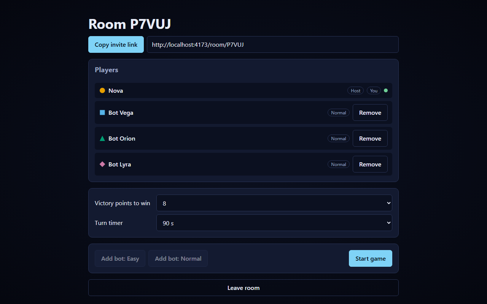
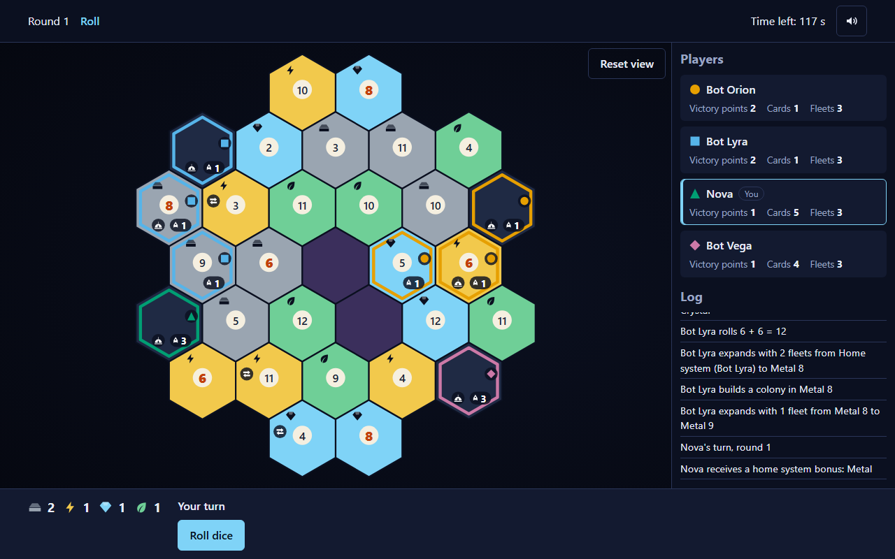
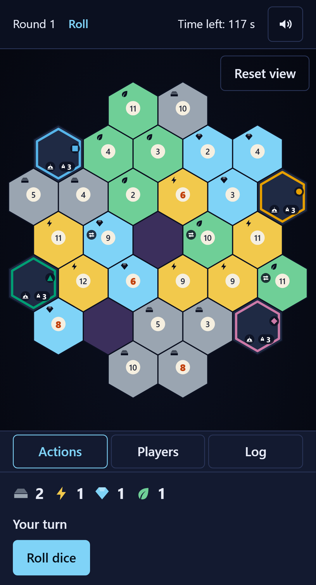

# Starhold

[](https://github.com/toma1203/starhold/actions/workflows/ci.yml)

Starhold is a free online space strategy board game for 2 to 4 commanders. Claim sectors of a hexagonal galaxy, gather resources, trade with your rivals, build colonies and starbases, and fight for control. The first commander to reach the victory target wins.

English | [Hrvatski](#hrvatski)







## Features

- Live multiplayer for 2 to 4 players over WebSockets; share a five-letter room code or an invite link.
- Bots (Easy and Normal) fill empty seats, so you can play alone or with a friend.
- English and Croatian, switchable at any time.
- Works on phones and desktops, installable as a PWA, with keyboard and screen reader support.
- Turn timer (60, 90 or 120 seconds) with automatic bot play for absent players.
- Reconnect to your seat after a reload or a dropped connection.
- No accounts and no tracking.

## How to play

- **Goal:** earn victory points. A colony is worth 1, a starbase 2, and two awards (Largest Empire and Warlord) add 2 each. Be the first to reach the target (6, 8 or 10).
- **Your turn:** roll two dice and collect resources from the sectors with that number, then trade, build, expand, attack and fortify, and end your turn. On a 7 the pirates strike instead of production.
- **Resources:** Metal, Energy, Crystal and Biomass. A fleet costs Metal + Energy, a colony one of each resource, a starbase 3 Metal + 2 Crystal. Trade with the bank (4:1, or 3:1 with a trade station) or with other players.
- **Combat:** attack neighbouring sectors with your fleets, compare dice, and take the sector when the defender runs out of fleets.

The full rules are in the game itself on the **/rules** page ("How to play"), for example `http://localhost:5173/rules` during development.

## Local development

Requires Node.js 22 or newer.

```sh
npm install
npm run dev
```

Open http://localhost:5173. The Vite dev server proxies Socket.IO to the game server on port 3000.

## Tests

```sh
npm test        # unit and integration tests (engine, bots, protocol, server, web)
npm run e2e     # Playwright end-to-end games in a real browser (desktop and mobile)
```

The end-to-end tests run against the production build and need a browser, so the first time run `npm run build && npx playwright install chromium`.
To regenerate the README screenshots: `npm run build && npm run e2e -- --grep @screenshots`.

Other checks: `npm run lint` and `npm run typecheck`.

## Production build and run

```sh
npm run build
NODE_ENV=production node apps/server/dist/index.js
```

Then open http://localhost:3000 (health check: `/healthz`). One process serves the web app, the WebSocket game server and the health check.

| Variable              | Default                               | Purpose                         |
| --------------------- | ------------------------------------- | ------------------------------- |
| `PORT`                | `3000`                                | HTTP port                       |
| `STARHOLD_STATIC_DIR` | `apps/web/dist` (found automatically) | Override the web build location |

Or with Docker: `docker build -t starhold . && docker run -p 3000:3000 starhold`.

## Deploy to Render

1. Create an account at [render.com](https://render.com) and connect your GitHub account.
2. Click **New** and choose **Blueprint**.
3. Select the `toma1203/starhold` repository. Render reads `render.yaml`, builds the Dockerfile and deploys it; later pushes deploy automatically.

The free plan puts the service to sleep after a period of inactivity, so the first visit after a pause takes about 30 to 50 seconds while it wakes up. Rooms live in memory and do not survive a restart. The $7/month plan keeps the service awake and avoids the cold start.

**Share previews:** `og:image` in `apps/web/index.html` is a root-relative path (`/og.png`). Once the game has a real domain, change it to an absolute URL such as `https://your-domain/og.png` so that chat apps and social networks can show the preview image.

## Architecture

An npm-workspaces monorepo, TypeScript everywhere:

| Path                | Package                 | Role                                                                    |
| ------------------- | ----------------------- | ----------------------------------------------------------------------- |
| `packages/engine`   | `@starhold/engine`      | Pure rules engine: map generation, actions, combat, scoring, seeded RNG |
| `packages/bots`     | `@starhold/bots`        | Easy and Normal bot players built on the engine                         |
| `packages/protocol` | `@starhold/protocol`    | Socket event names and zod schemas shared by client and server          |
| `packages/i18n`     | `@starhold/i18n`        | English and Croatian strings                                            |
| `themes/space`      | `@starhold/theme-space` | Colours, shapes and icons of the space theme                            |
| `apps/server`       | `@starhold/server`      | Express and Socket.IO server: rooms, game loop, timers, rate limiting   |
| `apps/web`          | `@starhold/web`         | React single-page app (Vite), PWA, Playwright end-to-end tests          |

The server is authoritative: clients send intents, the engine validates them, and each player receives a filtered view of the state.

## License

All rights reserved. The source is public for viewing only; see [LICENSE](LICENSE).

---

## Hrvatski

Starhold je besplatna online svemirska strateška društvena igra za 2 do 4 zapovjednika. Osvajajte sektore heksagonalne galaksije, skupljajte resurse, trgujte s protivnicima, gradite kolonije i zvjezdane baze i borite se za kontrolu. Pobjeđuje prvi zapovjednik koji dosegne ciljni broj bodova.

### Mogućnosti

- Višekorisnička igra uživo za 2 do 4 igrača preko WebSocketa; podijelite kod sobe od pet znakova ili poveznicu za pozivnicu.
- Botovi (laki i normalni) popunjavaju prazna mjesta, pa možete igrati sami ili s prijateljem.
- Engleski i hrvatski, uz promjenu jezika u bilo kojem trenutku.
- Radi na mobitelima i računalima, može se instalirati kao PWA, uz podršku za tipkovnicu i čitače zaslona.
- Mjerač vremena poteza (60, 90 ili 120 sekundi) uz automatsku igru bota za odsutne igrače.
- Povratak na svoje mjesto nakon osvježavanja stranice ili prekida veze.
- Bez računa i bez praćenja.

### Kako se igra

- **Cilj:** skupite pobjedničke bodove. Kolonija vrijedi 1, zvjezdana baza 2, a dvije nagrade (Najveće carstvo i Ratni vođa) donose po 2. Prvi do cilja (6, 8 ili 10) pobjeđuje.
- **Vaš potez:** bacite dvije kocke i uzmite resurse sa sektora s tim brojem, zatim trgujte, gradite, širite se, napadajte i pregrupirajte, pa završite potez. Na broju 7 umjesto proizvodnje djeluju pirati.
- **Resursi:** metal, energija, kristal i biomasa. Flota košta metal + energiju, kolonija po jedan od svakog resursa, zvjezdana baza 3 metala + 2 kristala. Trgujte s bankom (4:1, ili 3:1 uz trgovačku stanicu) ili s drugim igračima.
- **Borba:** napadajte susjedne sektore svojim flotama, usporedite kocke i preuzmite sektor kad branitelju ponestane flota.

Cjelovita pravila nalaze se u samoj igri na stranici **/rules** ("Kako igrati"), npr. `http://localhost:5173/rules` tijekom razvoja.

### Lokalni razvoj

Potreban je Node.js 22 ili noviji.

```sh
npm install
npm run dev
```

Otvorite http://localhost:5173. Vite razvojni poslužitelj prosljeđuje Socket.IO na poslužitelj igre na portu 3000.

### Testovi

```sh
npm test        # jedinični i integracijski testovi (engine, botovi, protokol, poslužitelj, web)
npm run e2e     # Playwright end-to-end igre u pravom pregledniku (računalo i mobitel)
```

End-to-end testovi rade nad produkcijskim buildom i trebaju preglednik, pa prvi put pokrenite `npm run build && npx playwright install chromium`.
Ponovno generiranje snimki zaslona za README: `npm run build && npm run e2e -- --grep @screenshots`.

Ostale provjere: `npm run lint` i `npm run typecheck`.

### Produkcijski build i pokretanje

```sh
npm run build
NODE_ENV=production node apps/server/dist/index.js
```

Zatim otvorite http://localhost:3000 (provjera zdravlja: `/healthz`). Jedan proces poslužuje web aplikaciju, WebSocket poslužitelj igre i provjeru zdravlja.

| Varijabla             | Zadano                              | Svrha                        |
| --------------------- | ----------------------------------- | ---------------------------- |
| `PORT`                | `3000`                              | HTTP port                    |
| `STARHOLD_STATIC_DIR` | `apps/web/dist` (pronalazi se samo) | Promjena lokacije web builda |

Ili s Dockerom: `docker build -t starhold . && docker run -p 3000:3000 starhold`.

### Objava na Renderu

1. Napravite račun na [render.com](https://render.com) i povežite svoj GitHub račun.
2. Kliknite **New** i odaberite **Blueprint**.
3. Odaberite repozitorij `toma1203/starhold`. Render pročita `render.yaml`, izgradi Dockerfile i objavi uslugu; svaki sljedeći push objavljuje se automatski.

Besplatni plan uspavljuje uslugu nakon razdoblja neaktivnosti, pa prvi posjet nakon stanke traje otprilike 30 do 50 sekundi dok se usluga ne probudi. Sobe žive u memoriji i ne preživljavaju ponovno pokretanje. Plan od 7 USD mjesečno drži uslugu budnom i izbjegava taj hladni start.

**Pregled pri dijeljenju:** `og:image` u `apps/web/index.html` je putanja relativna na korijen (`/og.png`). Kad igra dobije pravu domenu, promijenite je u apsolutni URL, npr. `https://vasa-domena/og.png`, kako bi aplikacije za chat i društvene mreže mogle prikazati sliku pregleda.

### Arhitektura

npm workspaces monorepo, svugdje TypeScript:

| Putanja             | Paket                   | Uloga                                                                                   |
| ------------------- | ----------------------- | --------------------------------------------------------------------------------------- |
| `packages/engine`   | `@starhold/engine`      | Čisti engine pravila: generiranje mape, akcije, borba, bodovanje, seedani RNG           |
| `packages/bots`     | `@starhold/bots`        | Laki i normalni botovi izgrađeni na engineu                                             |
| `packages/protocol` | `@starhold/protocol`    | Nazivi socket događaja i zod sheme koje dijele klijent i poslužitelj                    |
| `packages/i18n`     | `@starhold/i18n`        | Engleski i hrvatski tekstovi                                                            |
| `themes/space`      | `@starhold/theme-space` | Boje, oblici i ikone svemirske teme                                                     |
| `apps/server`       | `@starhold/server`      | Express i Socket.IO poslužitelj: sobe, petlja igre, mjerači vremena, ograničenje brzine |
| `apps/web`          | `@starhold/web`         | React aplikacija (Vite), PWA, Playwright end-to-end testovi                             |

Poslužitelj je mjerodavan: klijenti šalju namjere, engine ih provjerava, a svaki igrač dobiva filtrirani prikaz stanja.

### Licenca

Sva prava pridržana. Izvorni kod je javan samo za pregled; vidi [LICENSE](LICENSE).
